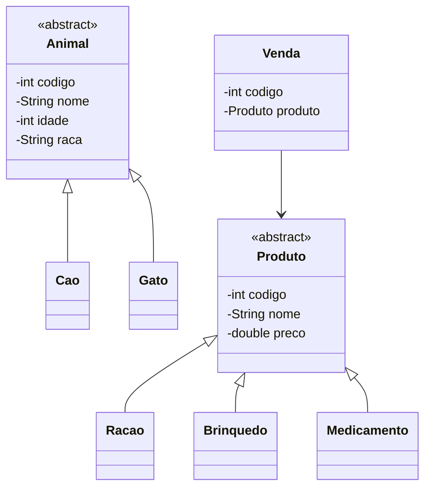

# Sistema Clínica Veterinária

Sistema em Java, executado no console, para gestão de uma clínica veterinária: cadastro, consulta, atualização e remoção de animais, produtos e vendas.

> Projeto final da disciplina de Programação Orientada a Objetos (POO) do curso Técnico em Informática, Colégio SATC.

## Funcionalidades

Animais (cães e gatos)
- Cadastro com código, nome, idade e raça
- Busca, atualização e remoção por código

Produtos (rações, brinquedos e medicamentos)
- Cadastro com código, nome e preço
- Busca, atualização e remoção por código

Vendas
- Registro de venda vinculada a um produto, com código único
- Busca e remoção por código (para corrigir uma venda, ela é removida e registrada novamente)

## Conceitos de POO aplicados

| Conceito | Onde aparece |
|---|---|
| Classes abstratas | `Animal` e `Produto` definem a base comum |
| Herança | `Cao` e `Gato` herdam de `Animal`; `Racao`, `Brinquedo` e `Medicamento` herdam de `Produto` |
| Polimorfismo | Animais e produtos são tratados pela classe base nas listagens e buscas |
| Encapsulamento | Atributos privados com acesso por getters e setters |
| Associação | `Venda` está associada a um `Produto` |

## Diagrama de classes



## Exemplo de uso

```
===== CLÍNICA VETERINÁRIA =====
1 - Animais
2 - Produtos
3 - Vendas
0 - Sair
Escolha uma opção:
```

> Ajuste este bloco para ficar igual ao menu real do seu programa, ou substitua por um print do terminal.

## Tecnologias

- Java
- Programação Orientada a Objetos
- `Scanner` para entrada de dados no console

## Como rodar

```bash
git clone https://github.com/1kaiki/Sistema_ClinicaVeterinaria.git
cd Sistema_ClinicaVeterinaria/src
javac *.java
java Main
```

Ou abra a pasta no IntelliJ IDEA, Eclipse ou NetBeans e execute a classe `Main`.

## Autor

Kaiki Mariano
